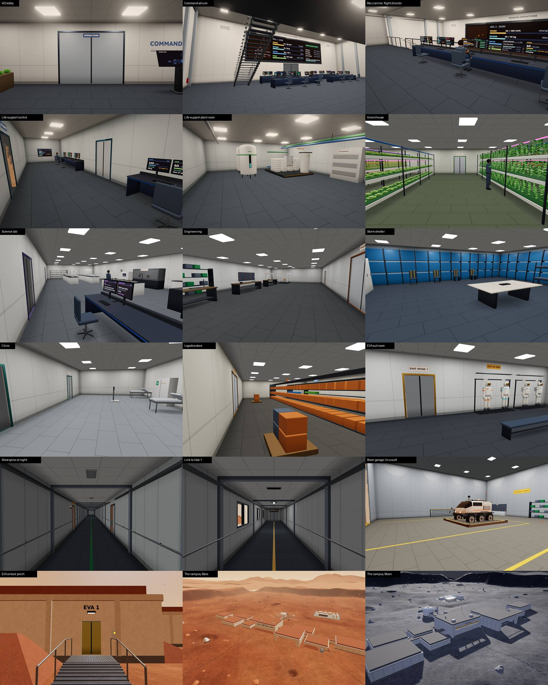

# ASTRA v7: final report

What the v7 overhaul built, measured on one machine, with what is not done. The plan and the decisions behind it
are in [V7_PLAN.md](V7_PLAN.md); design notes for the campus are in [HABITAT.md](HABITAT.md#v7-the-colony-campus-around-hab-1).

## 1. Implemented

**First person (phase A).** Horizontal field of view setting (85° default, 70–100°, vertical worked out per screen
shape), pitch ±83°, E only uses what is in plain sight (a line-of-sight test against walls and closed doors),
a re-entry checkpoint per mission run. `src/scene/walk.ts`, `src/sim/home.ts`, `src/state/walk.ts`.

**The colony campus (phases B, C, D).** `src/sim/base.ts` and `src/sim/furniture.ts` describe it once; everything
else reads them.
- 12 major structures (A command HQ, B Hab-1, C life support, D science lab, E greenhouse, F clinic, G engineering,
  H EVA complex, I rover garage, J logistics, K storm shelter, L power compound), a reactor compound, a yard lock,
  a 30 m link to Hab-1 and two pressurised spines. About 200 m end to end.
- 31 rooms and corridors in the campus (45 walkable spaces with Hab-1's 14), on two floors in the HQ (a
  double-height operations hall, a feature stair, the command mezzanine).
- Every building furnished from data (`FURNITURE`): consoles, plant, racks, tanks, beds, benches, printers,
  shelves. Walking collides with each piece; the 3D model builds each in its box.
- Windows cut through the walls with reveals and glass, showing the real outside. Sunlight comes only through a
  room's own windows (an exact ray test in the shader), so there are no light leaks at corners. Each room's own
  lamps are selected per vertex; the campus copies Hab-1's lamp colour (night, low battery, power cut).
- Exteriors: berms of regolith at the angle of repose, porches, pilasters, cornices, roof plant, the HQ's dish
  and mast, window glow panes for when an inside isn't drawn.
- Two interlocked airlocks (`src/sim/airlock.ts`): the inner and outer doors never open together; the panel pumps
  down and fills; beacons and door lights show the real state. Walking goes through the outer door onto the
  porch and out.
- World and rovers: the world grew to 540 m, sites re-placed round the garage (trips measured, rover speed and
  drain retuned so trips stay classroom-length), graded ground under the campus, rover and suited-walker collision
  against every building. Saves migrate from version 1 (`src/state/save.ts`).
- Missions open the campus in three stages; doors into a building a mission hasn't got stay locked.

**Function and life (phase E).**
- 21 stations (`src/sim/stations.ts`, `src/ui/walk.tsx`): live numbers from `flows()`, a cause-and-effect sentence,
  a sourced fact. 12 have controls, each an existing game action with the HUD's rules and costs:
  - switch the Oxygen Maker, the Water Recycler or any load on or off (life support's consoles, the HQ's power
    board, engineering's power desk);
  - set the grow lights (greenhouse panel);
  - start a repair (repair bay, alerts board);
  - take or leave shelter (shelter console, alerts board);
  - send either rover (HQ dispatch table, garage service board);
  - replay CAPCOM's last message (comms console);
  - open the build planner (construction console).

  E opens a station; click its buttons or press 1–9. The oxygen plant's access door and the sample freezer swing
  open while you look. Status lamps, gauges, shelf stock, crops and grow lights follow the state
  (`src/scene/campus/dress.ts: keepInStep`).
- Crew walking (`src/sim/nav.ts`, `src/sim/crew.ts`, `src/scene/crewwalk.ts`):
  - the four crew walk their routine between Hab-1 and the campus on routes found over the real walls and
    furniture, using both stairs;
  - a jointed walk cycle; sitting, lying, the treadmill and the cycle;
  - doors open for them; they keep a step apart and to the right;
  - out-of-sight stretches are skipped, so they keep up with the 3.5 s training hour without appearing in view;
  - reactions only to real state: a storm warning sends the commander to the alerts board, a flat battery sends
    Alex to the power desk, a repair sends Noor to the repair bay, and sheltering crew walk into the campus
    shelter.
- Guidance:
  - a colony tour (`src/sim/tour.ts`) of nine stops in walking order, with an arrow along the real route (redone
    as you walk, with stair and airlock hints) and a beacon over the stop;
  - a floor plan (M) per floor (`src/ui/floorplan.tsx`);
  - Back to HQ, a stated simulator shortcut that is refused in a suit;
  - a screenshot mode (U) that keeps alerts and suit readings.
- Sound: grating footsteps in the airlocks and dust lock, concrete in the garage; the plant room's hum follows its
  machines and everything slows in a blackout; storm beacons at the shelter, whose door stands open in a storm;
  the storm and background sounds redesigned (calmer room tone, gusting muffled Mars wind, no outdoor sound on the
  Moon).

**QA and release (phase F).**
- A debug visualiser: `?debug`, then the backquote key or `__astra.viz(true)`. It draws collision segments by kind,
  pressure zones, drawn buildings, the walker's body, the interaction ray, and the crew's and the tour's routes.
- 18 fixed campus review shots and the brief's seven performance views in `src/dev/qc.ts` (`__qc.capture('v7',
  ['C'])`, `__qc.perf7()`).
- The greenhouse's crops thinned from 0.96 M to about 0.6 M triangles after measuring.

## 2. Before and after

| | v6 | v7 |
|---|---|---|
| Walkable area | one 10 m two-storey habitat, 14 rooms | that habitat plus a 200 m campus: 12 major structures, 31 more rooms and corridors |
| World | 300 m square | 540 m square, sites re-placed round the garage |
| Going outside | a hatch that plays a cycle and puts you out | two real airlocks with interlocked doors you walk through |
| Things to use indoors | 14 look-closer cards | those, plus 21 stations, 12 with real controls |
| Crew | shown in four static poses at their next place | walk their routine between buildings, sit, lie, exercise, take shelter |
| Finding your way | a six-stop tour of Hab-1 | a nine-stop colony tour with a route arrow and beacon, a floor plan, Back to HQ |

Review shots (eye level, fixed cameras) are written to `~/Downloads/ASTRA-V7-QC/shots/v7-C*.jpg` by
`__qc.capture('v7', ['C'])`: the entrance lobby, the command atrium, the mezzanine with the commander at work, life
support (control room and plant room), the greenhouse with Sam at the racks, the lab, engineering, the shelter, the
clinic, logistics, the EVA suit room, the west spine at night, the link, the garage in a suit, the EVA porch, and
the whole campus from the air on Mars and the Moon.

## 3. Architecture

Unchanged layering: pure deterministic simulation (`src/sim`) → state (`src/state`) → 3D and UI (`src/scene`,
`src/ui`). New plan data lives in `src/sim` and is read by the 3D model, collision, routes, the floor plan and
the tests, so they cannot drift apart. Stations and the crew's routine are pure functions of `GameState`; the
scene only reads them, and the only way a station changes the game is the store's existing `act()` and
`sendRover()`. See [ARCHITECTURE.md](ARCHITECTURE.md).

## 4. Testing and measured performance

- `npm test`: 20 test files, 170 tests, all passing (v6: 123). New: the campus plan and its walls, the airlock
  interlock, stations (reachable, in plain view, controls change `flows()` exactly as the HUD's actions do), routes
  (across floors and the whole campus, every leg clear of walls, none through an airlock or into an unbuilt wing),
  crew places, the tour, save migration, sound.
- `npm run build`: passes (type check and production build).

**Machine and method.** Apple M4 (16 GB), macOS 26.6, Chromium 152 (ANGLE Metal), a 1280×800 viewport. Pixel
ratio 1 (Low), 1.5 (High: 1920×1200 pixels, a little over 1080p), 2 (Ultra). Each figure is the wall time per
frame for 10 frames after a pixel read-back, which makes the GPU finish its work; it is not vsync-limited FPS. The
browser pane was in the background, which can throttle timers but not these synchronous frames. Same method,
cameras and machine for v6 (commit a10e312) and v7. All figures are milliseconds per frame (lower is better).

v6 against v7 on the views both have (Moon, ms per frame, draw calls in brackets):

| View | Low v6 | Low v7 | High v6 | High v7 | Ultra v6 | Ultra v7 |
|---|---|---|---|---|---|---|
| Overview | 5.8 (513) | 5.3 (317) | 11.7 (898) | 10.5 (673) | 54.6 (1782) | 46.3 (1337) |
| Habitat | 6.0 (425) | 4.9 (266) | 10.8 (790) | 10.3 (518) | 48.2 (1566) | 42.9 (1027) |
| Inside: galley | 5.1 (181) | 4.3 (122) | 12.7 (641) | 13.0 (448) | 35.6 (645) | 32.8 (452) |
| Inside: landing | 6.3 (288) | 6.3 (268) | 13.3 (748) | 11.3 (599) | 36.6 (752) | 35.4 (603) |

The colony adds no cost to the views v6 had: only the building you're in and its doorway neighbours are drawn.

v7's campus views (Mars, every building, ms per frame and draw calls):

| View | Low | High | Ultra |
|---|---|---|---|
| Overview | 5.3 (308) | 11.0 (640) | 43.5 (1271) |
| Command atrium | 6.1 (456) | 13.7 (638) | 37.0 (642) |
| Greenhouse, full of crops | 11.1 (153) | 19.9 (262) | 47.3 (266) |
| Long corridor (west spine) | 5.5 (243) | 11.9 (452) | 35.5 (456) |
| Garage, in a suit | 8.1 (635) | 11.6 (929) | 46.7 (1847) |
| Outside the EVA complex in a dust storm | 3.5 (46) | 8.0 (214) | 37.4 (412) |
| Wide view of the whole base | 7.0 (569) | 11.8 (1055) | 47.5 (2248) |

The greenhouse is the heaviest room: its 1,900 crop instances were thinned after the first measurement (from
15.0 to 11.1 ms on Low and 22.1 to 19.9 ms on High). Each figure is the middle of three runs; the first frame
after moving the camera to a new view is slower (shaders and uploads) and is left out.

Read as frame rates: High holds about 50 FPS in the greenhouse and 70–120 FPS elsewhere at 1920×1200 pixels on
this machine; Low runs every view at 90 FPS or more. Ultra (twice the pixel density, ambient occlusion, edge smoothing, 4096 shadow maps)
runs at 20–30 FPS. It is the premium tier and never steps down on its own; Auto steps down when frames are slow.

## 5. Known limitations

- **Building B is Hab-1** (the round two-storey home), not a new 30×16 m residence, and the power compound outside
  is simple fenced boxes. There are no outdoor walkways or conduits between buildings (the brief's connector
  type 2).
- **Crew walking is for show.** Where they are doesn't change the simulation (the simulation knows only home,
  rover, EVA and shelter). Out of sight they arrive at once; in view they walk at a person's pace and can lag the
  routine. They have no avoidance beyond keeping a step apart and to the right, and you can walk through them.
  They don't use the airlocks (rover trips and Alex's EVA are hidden while out).
- **Consoles are a second way in.** Every control is also on the HUD, which stays the quick way. Some readings
  are fixed facts, not simulated (the freezer's −80 °C, the science rover's RTG).
- **Measured on one machine** (above), with the pane in the background. No phone or Chromebook figures yet; the
  Low tier is the fallback (same rooms, collision and stations).
- **Screens** are drawn on 44 canvases (one draw each); a per-console atlas would cut that. The terrain mesh is
  drawn whole, not in chunks.
- **Not built:** an outdoor suit sound pass for the campus porches (the suit's breathing and fans are there), a
  repair "manual maintenance" mechanic, pressure zones that can leak.

## 6. Quick demo route for judges (about 3 minutes)

1. **Settings → Unlock every mission**, mission map → **Mars Colony** → Start, skip the tutorial. Press **B** and
   build a **Greenhouse** (press **3** to speed up, **1** to slow down).
2. **V**, then **Back to HQ**: the operations hall, the display wall live, the commander on the mezzanine. **E** on
   the front-left console (power board).
3. West through the hall's side door and along the spine to **life support**. **E** on the oxygen plant controls,
   **1** switches the Oxygen Maker off (card, HUD and status lamp change together), **1** again to switch it back.
4. Next door west, the **greenhouse**: **E** on the panel by the door, **3** (high) then **1** (off). The lights dim
   and food grown falls to zero.
5. Back along the spine to the **storm shelter** (amber beacons): **E** on the dose console.
6. **Back to HQ**, east to the **EVA complex**: **E** at the suit rack, through the dust lock, **E** on the airlock
   panel, out onto the porch, west to the **garage**'s side door, **E** on the service board and send the crew rover.

**Take a tour** walks the same route with an arrow and a beacon; **M** shows the floor plan.
